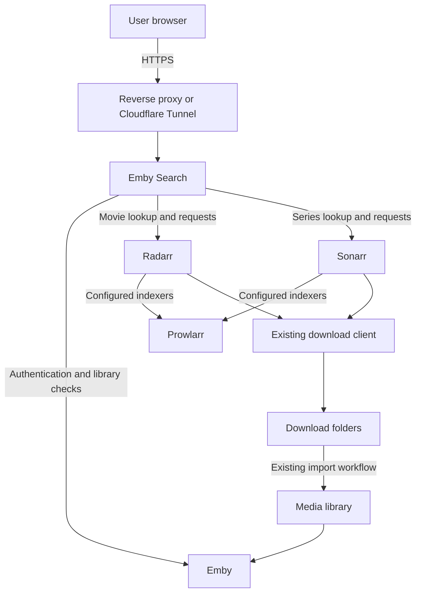

# Emby Search

A small media-request portal for existing Emby users. Sign in, find a movie or
series, select **Add to Emby**, and follow its download/import status beneath
a simple search field.

Emby Search is an independent, MIT-licensed project. It is not affiliated with
Emby, Radarr, Sonarr, Prowlarr, or their maintainers.

## How it works



The portal searches titles through Radarr/Sonarr metadata lookup. Those services
select releases through their existing indexers and manage downloading and
importing. Prowlarr can supply the indexer configuration. The portal needs no
Prowlarr, download-client, NAS, SSH, or Cloudflare API credentials.

- Movies, TV, anime, and cartoons, with configurable destination folders.
- Existing Emby authentication; any enabled account may request media.
- Entire regular series monitored, including future episodes; specials excluded.
- Existing managed titles retain their paths and quality profiles.
- Persistent requests, deduplication, and per-user request history.
- Approximately 15-second browser updates and background status polling.
- Requested, searching, waiting, queued, downloading, importing, partly
  available, available in Emby, and needs-attention states.
- Emby provider-ID matching and links to available items.

## Prerequisites

Provide existing Emby, Radarr (v3 API), and Sonarr (v3 API) services reachable
from the Docker container. Configure Radarr/Sonarr root folders, quality
profiles, indexers, download client, and working imports first. The portal
neither provisions these services nor creates media mounts or hardlinks.

Install Docker with the Compose plugin. Public access requires an HTTPS reverse
proxy or tunnel. Cloudflare is optional. The tested application runtime is
Python 3.12; the Docker image uses a non-root user with UID/GID 10001.

## Quick start

The initial MVP is on the `initial-mvp` branch pending its first release.
After a release is published, use a chosen release tag for a stable deployment.

```sh
git clone https://github.com/carlbme/emby-search.git
cd emby-search
git checkout initial-mvp
cp .env.example .env
chmod 600 .env
docker compose build
```

Generate a unique encryption key locally:

```sh
docker compose run --rm --no-deps --entrypoint python portal -c \
  'from cryptography.fernet import Fernet; print(Fernet.generate_key().decode())'
```

Edit `.env` and replace all placeholders, including `PORTAL_ENCRYPTION_KEY`.
Use URLs reachable **from the container**; `localhost` inside the container
refers to the portal itself. Include any service URL base path, such as `/radarr`.

Prepare private persistent storage:

```sh
mkdir -m 700 data
docker compose run --rm --no-deps --user 0:0 --entrypoint python portal -c \
  'import os; os.chown("/data",10001,10001); os.chmod("/data",0o700)'
docker compose up -d
curl -fsS http://127.0.0.1:8000/healthz
```

The initialization command changes ownership of the new `data` directory only.
The application subsequently runs as UID 10001. For rootless Docker or SELinux,
apply your platform's volume ownership/label mapping as needed.

### Configuration

| Setting | Purpose |
|---|---|
| `RADARR_URL`, `SONARR_URL`, `EMBY_URL` | Required backend HTTP(S) base URLs |
| `RADARR_API_KEY`, `SONARR_API_KEY` | Required service API keys |
| `PORTAL_ENCRYPTION_KEY` | Required unique Fernet key for stored Emby tokens |
| `PORTAL_ORIGINS` | Required comma-separated browser origins, e.g. `https://requests.example.com`; no paths |
| `RADARR_PROFILE_ID`, `SONARR_PROFILE_ID` | Required positive IDs from the respective service |
| `MOVIE_ROOT`, `TV_ROOT` | Required absolute paths as seen by Radarr/Sonarr |
| `ANIME_ROOT`, `CARTOONS_ROOT` | Optional Sonarr destinations; blank values use `TV_ROOT` |
| `EMBY_PUBLIC_URL` | Optional browser-facing Emby URL; blank hides the link |
| `RADARR_HOST_HEADER`, `SONARR_HOST_HEADER` | Optional HTTP Host overrides for hostname-restricted private endpoints |
| `PORTAL_SECURE_COOKIE` | `true` by default; use `false` only for private HTTP development |
| `PORTAL_TRUSTED_PROXY_IPS` | Optional comma-separated immediate peer IPs trusted to supply `CF-Connecting-IP`; empty trusts none |
| `PORTAL_BIND_ADDRESS`, `PORTAL_PORT` | Compose bind settings; defaults `127.0.0.1:8000` |

Obtain API keys in each media service's **Settings → General**. Obtain profile
IDs from authenticated `GET /api/v3/qualityprofile` and root-folder paths from
`GET /api/v3/rootfolder`, or inspect the corresponding UI/API responses.
Radarr and Sonarr IDs may differ. Use a local API client and its private
credential storage rather than putting keys into shell history. Host overrides
must be configured on that client too if your service requires them.

No Emby administrator API key is needed: users authenticate with their own
accounts. Changing profiles/folders affects new titles; existing titles keep
their original settings. When a duplicate is requested under another category,
the first stored request's destination/type wins.

### HTTPS and ingress

For a proxy on the Docker host, forward the public hostname to
`http://127.0.0.1:8000` and preserve the public Host header. Set `PORTAL_ORIGINS`
to that exact HTTPS origin. Keep secure cookies enabled.

For a proxy/tunnel connector on another machine, set `PORTAL_BIND_ADDRESS` to
a reachable host interface and restrict published port 8000 to the connector's
source IP. Docker's published-port forwarding rules must be covered by the
firewall; a host INPUT rule alone may not protect that port. This repository
does not automatically modify host firewalls.

If using Cloudflare Tunnel, publish an HTTP application route to that private
endpoint. The connector maintains the outbound encrypted tunnel. LAN access
through the public hostname also requires working internal DNS resolution.

Only configure `PORTAL_TRUSTED_PROXY_IPS` when the immediate proxy is trusted
and overwrites/preserves a genuine Cloudflare client-IP header. Other proxies
and direct clients are rate-limited by their connection IP. The application
ignores generic forwarded-IP headers. With no trusted proxy, clients behind
one proxy share its limits.

For a private local HTTP trial, use `PORTAL_ORIGINS=http://localhost:8000`,
`PORTAL_SECURE_COOKIE=false`, and browse that exact origin. Do not reuse this
cookie setting for an Internet-facing deployment.

## Security and limitations

Passwords are forwarded to Emby and never stored. Portal sessions last 24 hours;
Emby tokens are encrypted in SQLite. Cookies are Secure by default, HttpOnly,
and SameSite Strict. Authenticated API calls revalidate the Emby account.
Requests are scoped to their associated users; mutations require the configured
origin and a CSRF token. Login/submission limits are 10 per minute per client
IP; searches are 20. Bodies are limited to 8 KiB. Browser responses use a
restrictive CSP, framing protection, and no-store caching.

The image is read-only, drops capabilities, disallows privilege escalation,
and bounds memory, processes, and logs. The encryption key lives with the local
configuration: token encryption does not protect against compromise of both
the database and key. Radarr/Sonarr API keys grant powerful application access.

Internal HTTP legs are not TLS-encrypted; use backend HTTPS where required.
Trust only controlled proxies and protect configuration and backups. There is
no separate approval queue, request quota, or MFA layer in this MVP.

Library checks use an active associated user's Emby token. Download/import
tracking continues after session expiration, but the user may need to sign in
again to confirm Emby availability. Availability status is shared for a title
requested by multiple users, although request lists remain user-scoped.

This is a single-process SQLite deployment. Do not run multiple replicas against
the same database or share it through NFS. Docker restarts exited containers;
an unhealthy health check alone does not restart a running container.

## Operations and redeployment

```sh
docker compose ps
docker compose logs --tail 100 portal
curl -fsS http://127.0.0.1:8000/healthz
```

`/healthz` checks the portal process, not the entire upstream stack. Generic
status messages retain requests through upstream outages; details are managed
in Radarr/Sonarr. Updates are manual: back up, check out a chosen release,
then run `docker compose up -d --build`. Pinned Python dependency hashes are
included. The Python base image tag is mutable, so record the built image/digest
when exact rollback reproducibility is needed.

### Backup

Make a consistent SQLite backup while the application is running:

```sh
docker compose exec -T portal python -m portal.backup /data/backups/portal-YYYYMMDD-HHMMSS.sqlite3
```

Choose a unique filename; the helper refuses to overwrite a backup and verifies
database integrity. Securely copy that backup and `.env` to private off-host
storage. Preserve the encryption key. A database-only backup cannot recover
encrypted sessions without their original key. Replication is not a backup.
Do not copy a live SQLite database without its WAL or a consistent backup.

### Restore or redeploy

On a new host, clone the same release, privately restore `.env`, build the
image, and prepare the `data` directory as above. Keep the service stopped.
For an existing installation, first create and verify a backup, then run
`docker compose stop portal` and preserve the complete old `data` directory
under a unique rollback name. Create a fresh `data` directory, place the verified
backup at `data/portal.sqlite3`, and set directory mode 700 and database mode
600 with ownership 10001:10001. Do not mix old WAL/SHM files with a restored
backup. Start with `docker compose up -d` and verify health, login, and request
history. Retain the rollback copy until the restore has been verified.

The portal stores no media. Its configuration references the separate media
services, whose own configuration, storage, and availability must be preserved.
Proxmox HA is an optional operator arrangement, not a prerequisite or an
installation action performed by this repository.

## Development and verification

```sh
python3.12 -m venv .venv
. .venv/bin/activate
pip install -r requirements-dev.txt
python -m pytest
python -m playwright install chromium
python -m portal_tests.browser_check
python scripts/docker-smoke.py
```

Tests use synthetic services and credentials. The browser smoke test exercises
login, title selection, download status, mobile width, and logout without
requesting real media. Set `PLAYWRIGHT_CHROMIUM_EXECUTABLE` to use an existing
Chromium binary instead. The Docker smoke test uses disposable configuration,
a random loopback port, and a separate volume to verify health and persistence.
CI also scans complete repository history for secrets.

## Roadmap

The MVP intentionally excludes download size/speed/ETA details and an interactive
installer. Planned follow-up work includes a guided setup/deployment flow that
collects endpoints and private credentials, validates configuration, and writes
local settings without exposing them in logs or Git.

## License

MIT. See [LICENSE](LICENSE).
